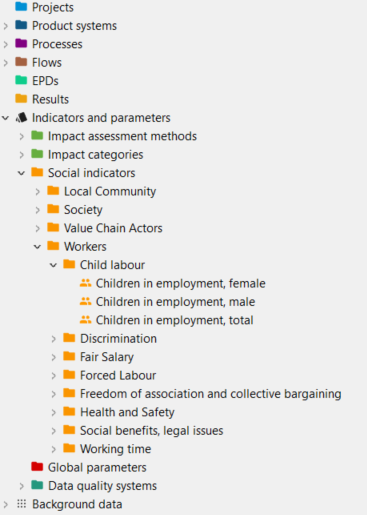
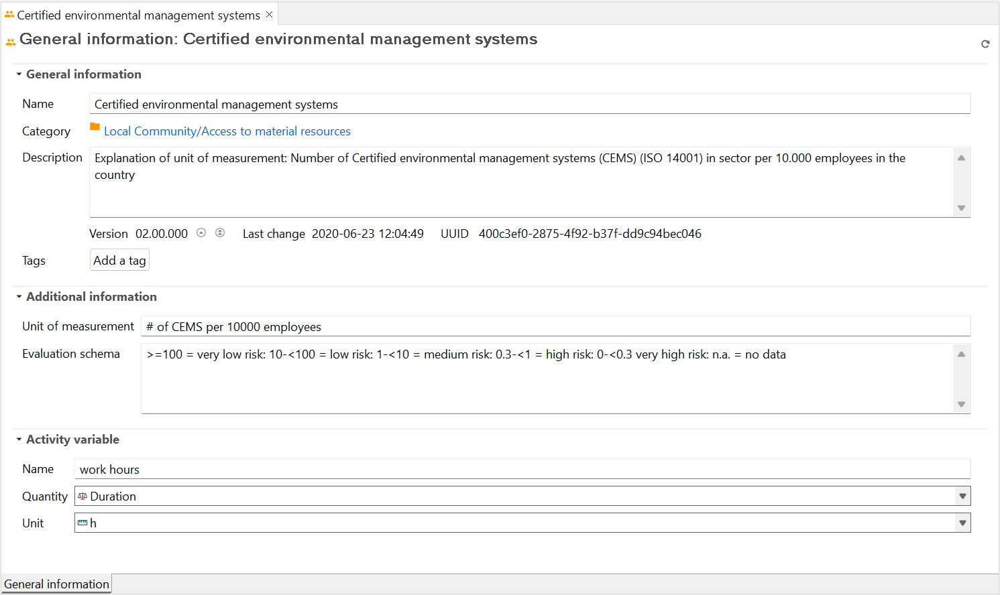
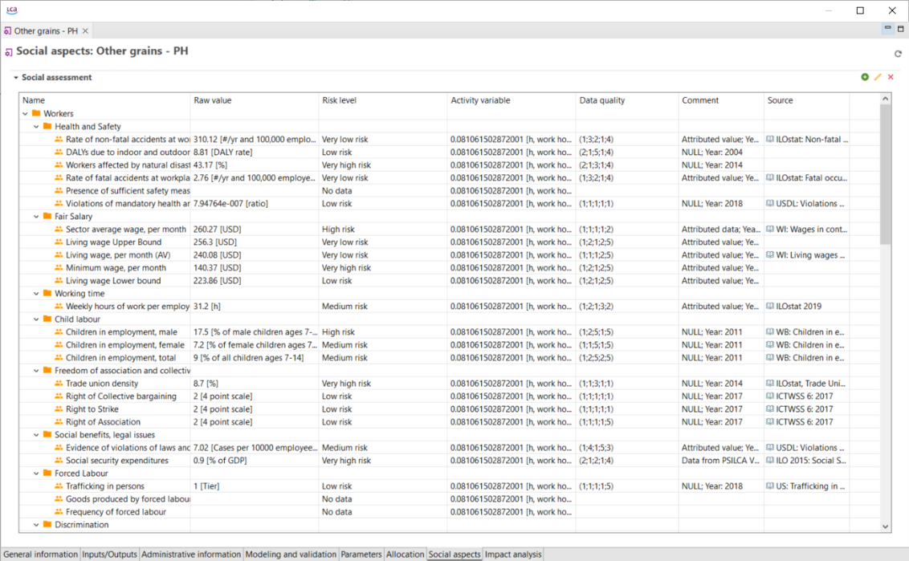
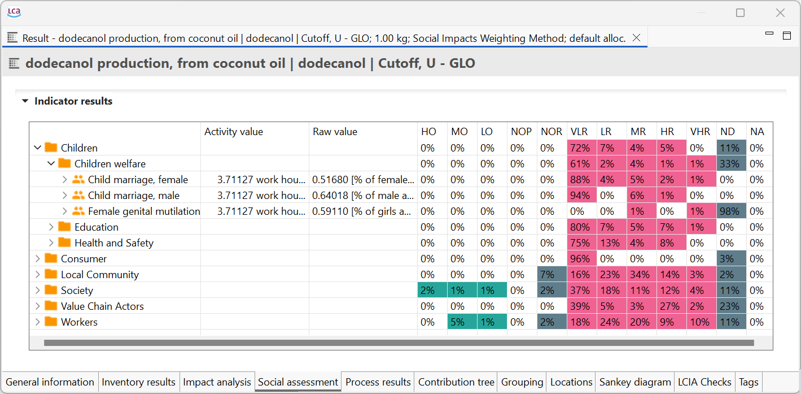

# Social aspects

openLCA can also be used to conduct social lifecycle assessments (SLCA) for any product or project. SLCA is a part of a sustainability assessment that focuses on the social impacts throughout a product's lifecycle. Guidelines for carrying out SLCA were developed (and were last updated in 2020) by the United Nations Environment Programme (UNEP) and can be freely accessed on their website.

Similar to conventional environmental LCA, there are background databases used for SLCA. In openLCA, PSILCA and SHDB are examples of social databases that can be used. You can also integrate soca, which is an add-on for ecoinvent LCI databases to carry out SLCA. Social LCA databases are available on [openLCA Nexus](https://nexus.openlca.org/database/), under the Database section.

In an active social database, you can find the "Social Indicators" in the "Indicators and parameters" directory (only if processes have social-related information):

  

To learn more about any social indicator, you can double-click on it. In the General information tab, additional information about the unit of measurement, evaluation schema and activity variable are displayed. 

  

Information regarding the social indicator according to each process can be viewed in the "Social Aspects" tab. Information on the raw values, risk level (evaluated according to the amount of the "raw value"), activity variable, data quality, comment and source can all be displayed. The risk-assessed indicators are characterised by the activity variable. For instance, for the time being, all indicators use working hours as an activity variable. To learn more about this and about each social indicator, it is recommended to visit the PSILICA manual which is available on [openLCA Nexus](https://nexus.openlca.org/database/PSILCA).

  

With openLCA 2.7, we have also added the Social assessment tab, which allows you to assess the social aspects of your product system. Once you have calculated your product system, the assessment is presented by stakeholder groups and subcategories, showing the associated opportunities and risks based on the raw values. Divided into stakeholder groups and subcategories, it will give you the opportunities or risks associated with the product system based on the raw values.

  

> **Note:** Please visit the [PSILCA 4.0 manual](https://nexus.openlca.org/ws/files/39578) chapter 2.7.2 A direct quantification of indicators in PSILCA’s life cycle calculation to understand how the social assessment tab is computed.

