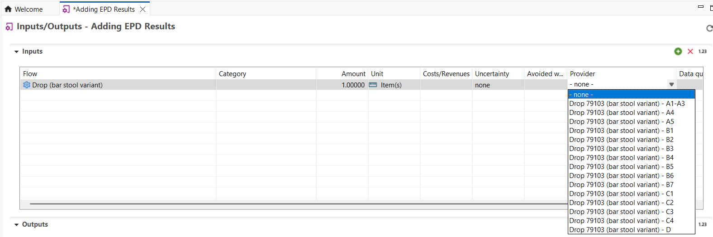
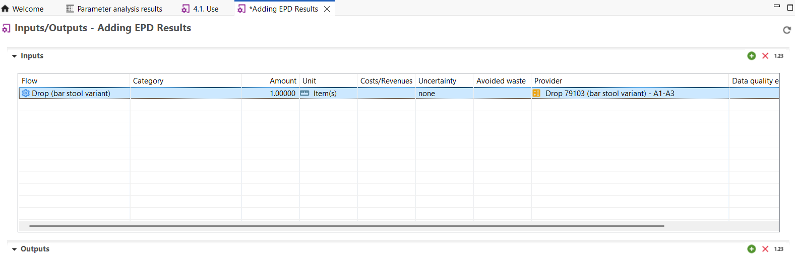
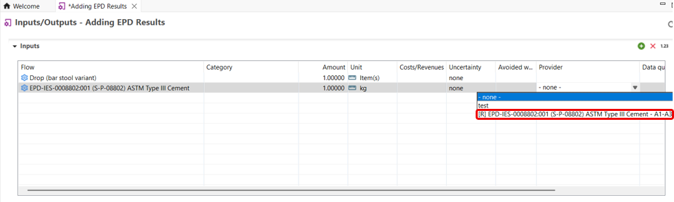
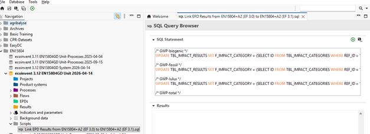
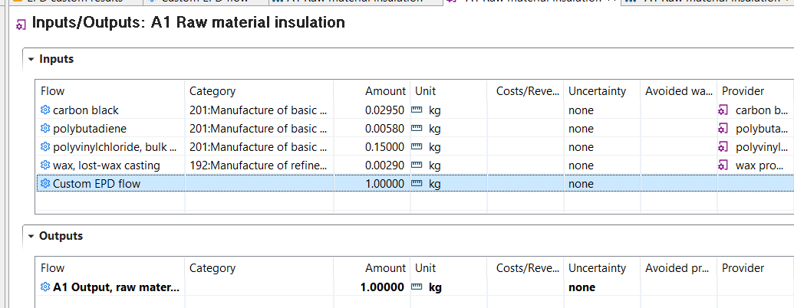
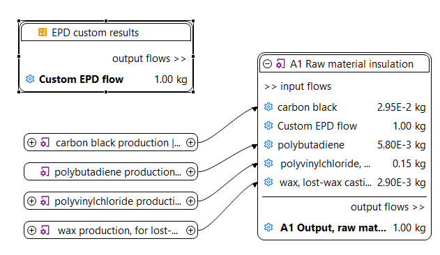
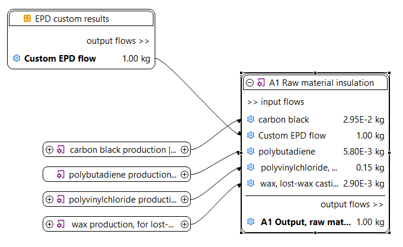

# Using results of EPDs in the product system

To connect EPD results to your product system, this can be done in two ways (1) adding the result output flow into your respective process (2) adding the result output flow through the model graph.

## Method 1: On process level

In openLCA v2.5.0, within the process, you can add the product flow corresponding to the EPD result as an input.
Then, as usual, use the provider dropdown to select the appropriate module (i.e., the process or result) you want to link to your system. Make sure that you still generate a product system prior to the calculations, as the ['direct calculation'](../cheat/direct.md) function does not work for now in combination with results.

**Bonus**: If your product flow is connected to normal processes and results, results are indicated by [R] as a prefix. 

_**Important**_: The LCIA results of a connected result are only used if their impact categories match the LCIA method you calculate with, because categories are matched by UUID. For example, EF 3.1 results are ignored when you calculate with TRACI or EF 3.0. To use several methods, add the categories of each method and fill in their results manually. If your results are based on EF 3.0, you can relink them to EF 3.1 with the SQL script “Link EPD Results from EN15804+A2 (EF 3.0) to EN15804+A2 (EF 3.1)”. It is available in the Scripts folder of databases that come with the EN15804+A2 add-on database. 

> **Note:** This step is optional if the result already contains the inventory results, and **it will calculate the impacts from these inventory results** in that case. If both LCIA results and inventory results are available, openLCA will always prioritize the inventory results, regardless of the present LCIA results. You don’t need to fill in the 'LCIA method' field to use an EPD’s LCIA results in product systems. However, if you do select an LCIA method, you will then only be able to choose impact categories from that method.

## Method 2: via modal graph edit mode

You can also add the EPD result’s output flow directly via the model graph edit mode by drawing the connection between your process and the EPD result. This method offers a visual way to integrate the flow into your product system.

The introduced or saved results can be directly used in a supply chain.

1.	The flow must be added to the inputs of a target inventory that will be connected with a respective result.

    
    _Linking the impacts with an inventory_

2.	Unlike the provider selection, the results can be connected to a respective flow only via the "model graph". 
Thus, a product system needs to be created first. After the supply chain is created, it is needed to open the "model graph" 
under the product system element and drag and drop the result into the editor area. It is important to keep 
track and select the correct reference flow to be able to link to the result. 

    
     _EPD example_

3.	Once the results are in the editor area, they can be connected to the flow manually. That is done by dragging a connection from the 
target flow to the results element.

    
     _EPD example_

4.	After all connections are established and the target amounts are set, it is important to save all changes prior to performing the impact assessment. Then, the results can be analyzed as usual.

>_**Notes:**_ 
  **For users using the Ecoinvent v3.9 EN15804+A2 add-on database or previous versions:** EPDs imported via ILCD formats cannot be integrated into the results of the EPD when utilized as part of a product system that is created on openLCA. Therefore, you must [manually add the EPD results](./adding_results_3rd_sources.md#adding-epds-manually) OR map the impact categories of the EPD results by creating a new process and adding suitable elementary flows representing each impact category. 
  **For users using the Ecoinvent v3.10 EN15804+A2 add-on database with openLCA v2.2:** EPDs imported via the ILCD format can now be directly integrated into the product system. You should use openLCA v2.2 with the ecoinvent v3.10 EN15804 add-on to import the EPDs and map them to the impact categories. However, we advise you to always verify that the impact categories are mapped correctly, as the online repository from which the EPD is imported does not always link the impact categories to their corresponding unique identifiers accurately.

