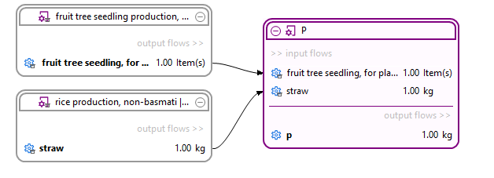

# _New_ Libaries in openLCA

Libraries are a new feature in openLCA 2.0. They are a tool that allows faster impact calculations and the use of processes, flows, 
impact categories etc. across unit process databases. The **faster impact calculation results** arise from **precalculated matrices** (see section "[Library file system](./file_system.md)" for more information). Databases can be exported as libraries and inversely these libraries can be added to existing databases. Also, check out our introductory [webinar](<https://www.youtube.com/watch?v=7Tv2NmxOLEU>). 
The data from these imported libraries can then be used normally in the database for LCA modelling and servers as a fixed background database. Additionally, libraries allow for a better overview when using the graphical editor, as some detail is hidden without compromising 
the accuracy of the impact calculations. 

 _Example of a library product system displayed in the model graph of openLCA (processes from the library are indicated as grey)_

The implementation of libraries brings various advantages to the users of openLCA:

- Libraries are not editable, meaning that the background data is write-protected
- A single library can be added to several compatible or empty databases. This ensures that the same background data sets are used across different models or even one foreground model can be connected to several libraries.
- A library is stored in a single file and can therefore be reviewed, certified, and versioned if needed
- Calculations are much faster because inventories are precalculated and require significantly less memory. Please note that data quality assessment and uncertainty analysis using Monte Carlo simulations are currently not supported for libraries.
- Foreground and background data are clearly separated. The foreground database contains the processes and assumptions specific to a study, while the library provides the common background data. However, in the contribution tree, the background data's detailed contribution is still visible (in contrast to system process databases).
- The number of links to product systems is reduced, and this, together with the pre-calculated background data, is beneficial for working with online tools such as onlineLCA.
- Importing and exporting foreground data is easier because shared background data remains in the library
- Libraries can be protected with usernames and passwords

Another advantage of using libraries is more efficient data exchange using the openLCA [Collaboration Server](<https://manuals.openlca.org/lca-collaboration-server/>), as library data is transferred only once and can then be referenced to multiple databases instead of being transferred separately for each database.

