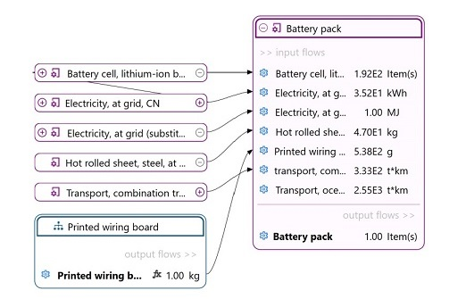
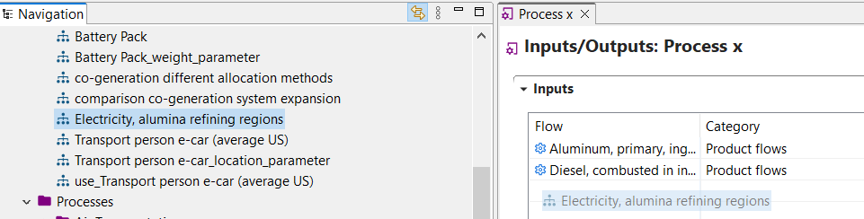
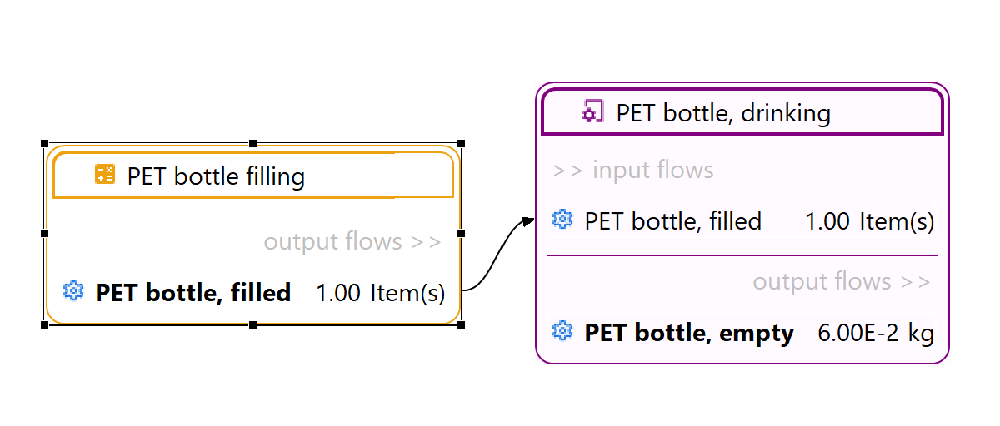
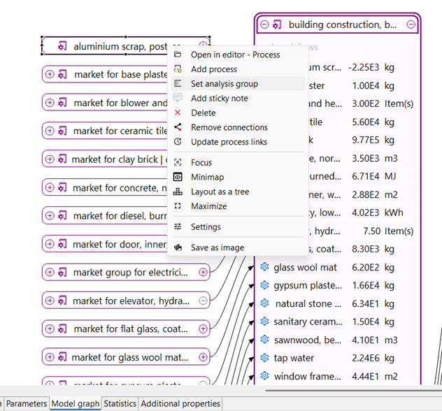
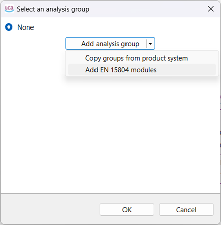
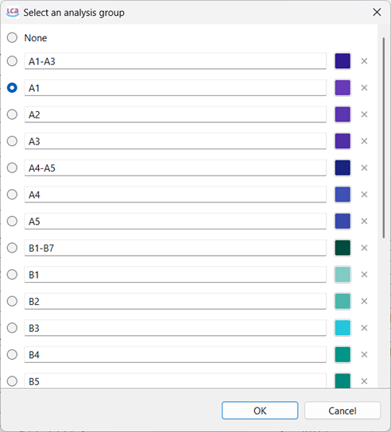
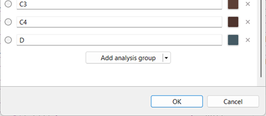
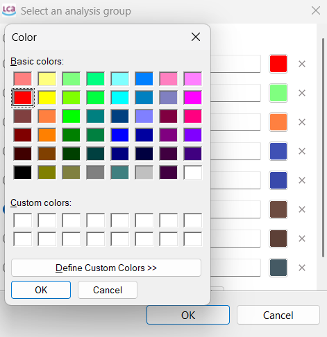
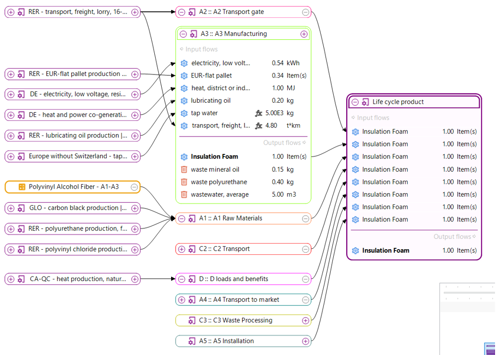

# Nested Product Systems

A product system can serve as the provider to another product system - the result is then a "nested" product system. For this, drag and drop a product system into the model graph of a different product system and connect it to one of the input flows via "search recipients for".

 _Nested product sysyems_

You will see the contributions of the sub-product system to the overall results, e.g. in the impact analysis and contribution tree results.

A product system can also be used as an input flow for a process. The quantitative reference flow of the product system will be added to the process.

  
_Drag-and-drop of a product system into the input flows of a process_

This is particularly helpful when working with EPDs. Check ["Using results of EPDs in the supply chain"](../epds/life_cycle_models.md) section for more details.

Details about nested product systems are available at this
[link](https://github.com/GreenDelta/olca-app/issues/72).

# Using results in product systems

As you will see (check ["Save and exports results chapter"](../res_analysis/save_export.md) section for details) you can now save your results and use them in different ways. Among them, once saved, you can drag results in a product system:

_Result dragged in a product system_

You can use this feature to complete the supply chain when the inventory is not known, if the method used is the same.
Is also particularly helpful when working with EPDs (check ["Using results of EPDs in the supply chain"](../epds/life_cycle_models.md) section for more details).

# Analysis Groups (new)

Since openLCA v2.4, you can conveniently categorize your product system's processes into various categories allowing later to group results. This is particularly helpful if you assign groups according to the EN15804+A2 modules as used for EPDs. Moreover, it allows us to analyze life cycle stages without changing the connectivity within the model graph. 

After creating the product system, you can hover over a process in the model graph, right-click, and choose the desired option as seen below:

A pop-up window will appear, allowing you to set up a new analysis group by clicking "add analysis group" or selecting "Add EN 15804" from the drop-down menu for predefined group analysis according to the EN15804+A2 lifecycle modules.

If you select "add EN 15804 modules", a pop-up window will appear allowing you to assign the selected process under any category. You can delete any group by clicking the "x" sign next to it. 

You can also create a new one, by clicking on “Add analysis group” at the end of the list:

It is also possible to set colors, by clicking on the color box in front of any group, to categorize the processes in the model graph, as shown below:

The chosen colors are then visible in the model graph respective to the group.

After saving the work, you can perform the calculatin and view the group analysis results in the “analysis groups” tab below the [results window](../res_analysis/res_analysis_groups.md).

